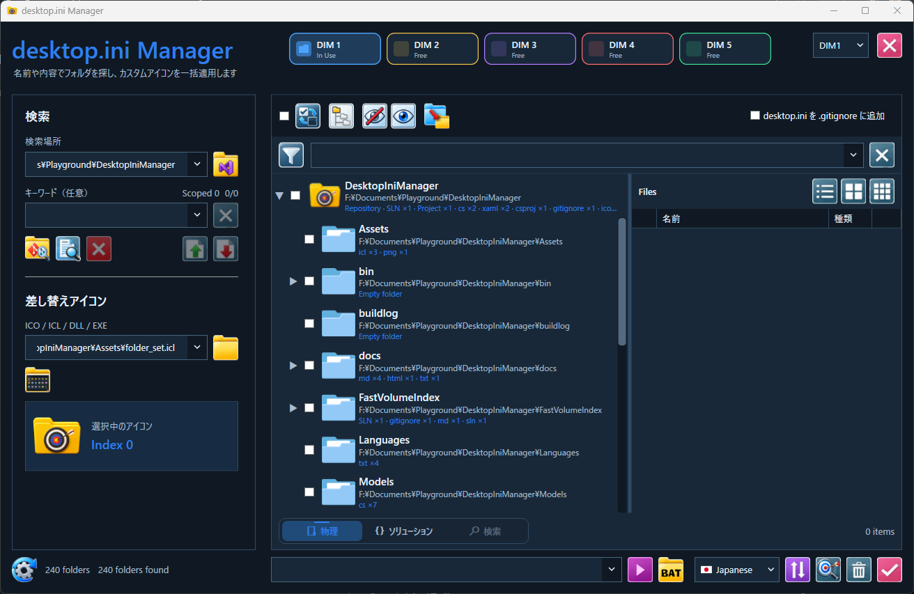
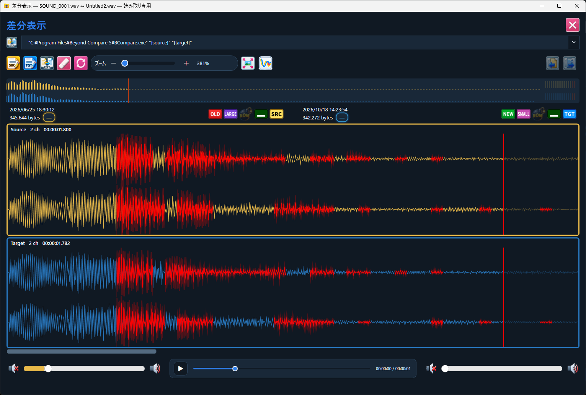

# DesktopIniManager v4.4.3

DesktopIniManager (DIM) is a Windows workspace for exploring development folders and Visual Studio solutions, finding files, running scoped searches, comparing folders, viewing differences, and managing folder icons through desktop.ini.

[Website](http://dim.zebrasoft.co.jp/) · [Japanese manual](http://dim.zebrasoft.co.jp/manual.html) · [GitHub downloads](https://github.com/K-Tamashiro/DesktopIniManager/releases) · [Japanese readme](docs/README.txt)



## Download and setup

Download **DesktopIniManager-v4.4.3-win-x64.zip** from the v4.4.3 GitHub release assets, rather than GitHub's source-code archive. A matching .zip.sha256 file provides its SHA-256 checksum. 

- Windows 10 or Windows 11, x64.
- .NET 10 Desktop Runtime (x64), installed separately.
- Visual Studio Build Tools / MSBuild or the .NET SDK for the corresponding solution build commands.
- An external editor or diff/merge tool is optional.

Extract into a fresh folder and run **DesktopIniManager.exe**. Keep all DLLs, JSON files, Assets, and Languages together. ExcelDataReader and the bundled PdfPig libraries are required for Document Grep. The default folder icon library is resolved from the application's Assets directory.

## Main features

- Five independent DIM process slots, each with its own settings and history.
- Dark, Light, and DIM1–DIM5 themes, restored on startup.
- Separate Code Grep and Document Grep profiles, with Excel/PDF content searching.
- Fixed single-root folder row, folder-name hit highlighting/counting, resizable columns, and saved pane/column widths.
- Source-yellow and Target-blue DIFF VIEW frames, a draggable difference map, and an all-lines / differences-only toggle whose state is saved on close.
- Incremental comparison results, folder-building progress, and one-way Source-to-Target selection of an existing same-name folder.
- Independently selectable comparison checks for modification date/time, file size, attributes (including BOM), and XXH128.
- Comparison evaluates enabled date/time, size, and BOM checks independently. XXH128 is calculated only for files present on both sides that have not already been classified as different by an enabled check.
- DIFF VIEW whitespace, inline-difference and line-ending markers, plus a progress bar while loading.
- Image/GIF, video, and MP3/WAV comparison in DIFF VIEW, including synchronized audio playback, independent Source/Target volume controls, and red highlighting of detected audio waveform differences.
- Updated icons for selected controls.

## Main window

Set a Target root and inspect its Physical tree or Visual Studio Solution structure. File search also matches folder names. Checked folders restrict File Search and Scoped Grep to their subtrees.

Selecting a physical folder lists files below it: immediate files appear first in white; descendant files use muted text. Solution view follows the useful parts of Solution Explorer, omitting management folders such as .git and .vs. Switch between the file list and two- or three-column icon views.

The tree supports check/uncheck all, inversion, expand/collapse, checked-folder filtering, name filtering, and compact/large display. Hits are marked, and selecting a search result reveals its containing folder. The Target root row stays visible in a single-root tree.

Context menus can set the Target, open Explorer, export tree / tree /f / file-list output to an editor, and pass a folder to Scoped Grep. Solution menus provide Visual Studio/MSBuild and .NET SDK builds using project configurations.

Choose icons from ICO, ICL, DLL, or EXE resources, apply them to checked folders through desktop.ini, or reset existing customizations. Optionally add desktop.ini to .gitignore. Empty/content icons and network/cloud presentation help distinguish folder states.

Drag folders out with their immediate files, or drag multiple files from the file list. The Batch File Launcher supports %d% (directory path), %f% (selected file path), and %n% (file name).

## Developer Differencer

Compare a yellow Source tree with a blue Target tree. Paths are indexed when selected; folder-label buttons provide explicit rescans. Source-to-Target folder matching selects an existing same-name folder under the current Target. It does not create folders or run in reverse.

Comparison checks can be enabled individually for **modification date/time**, **file size**, **attributes (including BOM)**, and **XXH128 content hash**. Enabled metadata and BOM checks remain independent: a date/time or size mismatch does not skip the BOM check. XXH128 is skipped when a file exists on only one side or any enabled preceding check already establishes a difference. With only XXH128 enabled, every file present on both sides is hash-compared. One-sided files/folders are included. Environment/build artifacts are normally excluded, with separate obj and bin visibility controls.

Comparison respects .gitignore files in each selected root and its descendants, including directory patterns, *, ?, character classes, **, anchored paths, escaped characters, and ! negation. Deeper rules override parent rules; children cannot be re-included while their parent directory remains excluded. A path ignored by either Source or Target is excluded from both sides of the comparison and from synchronization. Rules outside the selected roots and global Git excludes are not used. Rescan or compare again after editing ignore files. The ignore button to the right of the filter button opens the merged Source/Target exclusion list, with patterns ending in / sorted first and other patterns sorted below them, each in ascending order; it is disabled when the comparison has no exclusion rules. Checked rules exclude paths; clear a checkbox to disable that rule, then apply to rescan and update the current comparison tab. Other enabled exclusions and negation rules still apply. Cancel discards changes, and the middle button inverts the checkboxes. Choices are retained with the comparison history and used during synchronization; the .gitignore files are not modified.

Filter Same, Different, Source-only, Target-only, obj, bin, and checked items. Same files are hidden by default. The Same-check action can include identical files in synchronization or ZIP selections.

Keep up to 20 dated comparison tabs, newest on the left. Opening Developer Differencer restores the tab list asynchronously without running a comparison or displaying the previous result tree. Select a history tab to display its saved result. Restoration can be cancelled; the partial display is discarded and the saved history remains available. Closing waits for background history persistence before exiting. Delete tabs to make room at the limit. Refresh the whole comparison or the selected folder, and run Solution Clean where appropriate.

Create a ZIP from checked Source or Target files while preserving relative paths. Drag the ZIP icon to export the selected folder structure without creating an archive. Synchronization is available in either direction; review its direction and operations in the confirmation window.

## DIFF VIEW

The text comparison engine includes a modified version of [Matthias Hertel's Diff](https://github.com/mathertel/Diff), licensed under BSD-3-Clause. See the [attribution and modification notice](docs/licenses/Mathertel-Diff-NOTICE.md) and [complete license](docs/licenses/Mathertel-Diff-LICENSE.txt).

Launch just DIFF VIEW as an external two-file comparison tool:

```text
DesktopIniManager.exe -diff "C:\work\Source.txt" "C:\work\Target.txt"
```

Each invocation opens an independent process, even when all five DIM slots are occupied. It uses slot 1's theme, language and viewer settings without acquiring a slot, opening the main workspace or splash screen, or scanning folders. The process stays alive until its viewer closes. Source is on the left and Target on the right. Either file may be missing: the existing side opens against an empty opposite side, allowing added or deleted files to be reviewed. Quote paths containing spaces. Relative paths resolve from the caller's working directory. Invalid arguments, directory arguments, or a pair with neither file present show an error and exit with code 1; normal closing exits with code 0 (not a content-equality result).

Run `DesktopIniManager.exe -diff` without paths to open an empty DIFF VIEW. Drop a file onto the Source or Target side, or drop two files together to fill both sides in drop order. The first input selects text, image, video, or audio mode; files from different modes, unsupported binaries, and files already loaded on either side are rejected. MP3 and WAV belong to the same audio mode and can be compared together. The clear button (icon 140), immediately left of Reload, clears both sides and resets the mode. Clear and drop are available in all four modes, including viewers opened from Developer Differencer. A manually replaced pair is independent of the original comparison result.

For Git, add the following to your global `.gitconfig`, replacing the executable path with your installation path:

```ini
[diff]
    tool = dim

[difftool "dim"]
    cmd = DesktopIniManager.exe -diff "$REMOTE" "$LOCAL"

[difftool]
    prompt = false
```

Run `git difftool` (launch confirmation disabled by `prompt = false`). In GitKraken, select **Git Config Default** as the external diff tool. This configures two-file viewing, not a merge tool or the seven-argument `GIT_EXTERNAL_DIFF` interface. See the [Git difftool documentation](https://git-scm.com/docs/git-difftool) and [GitKraken external diff instructions](https://help.gitkraken.com/gitkraken-desktop/diff/).

Double-click a supported comparison file to open the read-only viewer. Text differences have syntax highlighting, original line numbers, colored Source/Target frames, and a central difference map. Supported images use a separate image view; unsupported binary formats are excluded.

- The **≠** icon switches to differences only; the **※** icon returns to all lines.
- Differences-only mode shows complete changed sections without unchanged context lines. Omitted sections have markers such as “52 filtered lines”.
- **Ctrl + 0** performs the same toggle. Closing the viewer saves its last mode for the current slot.
- Jump between sections/files, open either side in an external editor, or launch an external diff/merge tool.
- Show Space and Tab characters, inline differences, and line-ending marks in the text comparison.
- A progress bar indicates loading progress when opening DIFF VIEW.

DIM does not edit or merge file contents in this viewer. Scanning, searching, comparing, and viewing leave source contents unchanged. Explicit icon application, synchronization, Clean/build commands, ZIP/export, and external tools can write files.

## Image DIFF VIEW

Image comparison mode shows Source and Target side by side. BMP, JPG/JPEG, PNG, GIF, and TIFF/TIF (as well as the other supported image formats) use nearest-neighbor scaling without smoothing. Zoom ranges from 5% to 1600%; the pixel grid appears only at the maximum 1600%. ARGB values and relative coordinates are displayed at the pointer position. Each side can independently switch between its original image and the XOR overlay. The navigation map overlays both images and highlights differences.

For animated GIFs, a frame slider appears below the image panes. Move it and release to compare a composed frame as a still image; playback is not automatic. The shared range uses the larger frame count. A side with no frame at the selected index is shown as missing. Frame counts and original frame delays (milliseconds) are displayed. Transparent pixels, local frame rectangles, and background/previous-frame disposal are applied before comparison.

## Video DIFF VIEW

Video comparison displays Source and Target side by side with shared play/pause, a seek slider, current/total time, and zoom controls. Use Fit to fit both previews in the available area, or 100% to return to the original scale. Video preview is muted.

Recognized extensions are MP4, AVI, MKV, MOV, WMV, WebM, M4V, MPG, and MPEG. Playback uses Windows media support; the codecs installed on the computer determine which files can be decoded.

## Audio DIFF VIEW



The comparison view highlights detected differences in red while preserving the Source/Target colors and the shared time axis.

Open MP3 or WAV (`.wav` / `.wave`) files to review changes to voice guidance and other audio resources. Source appears above Target, with yellow and blue frames respectively. Both waveforms use the same time scale, based on the longer file. Mono audio has one waveform per pane; stereo audio has separate left/right channel waveforms.

Each pane header shows Sample Rate (kHz), Bit Depth (bit), and Bit Rate (kbps) after the channel count and duration. Values that differ between Source and Target appear in red. PCM bit rate includes the channel count: sample rate × bit depth × channels. MP3 shows its average encoded bit rate and Bit Depth: N/A, rather than the decoder's internal sample precision.

- Use the bottom-center play/pause button to play both inputs from the same position. Red vertical cursors mark the common playback position.
- The top overview shows Source/Target block waveforms with colored playback progress. Click it to seek. The meters at right show each side's output peak after volume adjustment on a -60 to 0 dBFS scale, and clear when paused or finished.
- Click a Source/Target pane (or its header), then press Ctrl+V to paste into that side. The pane context menu also offers explicit Source/Target paste actions. Clipboard text, bitmap images, standard WAVE audio, and copied files are loaded through private temporary files, cleaned up when the viewer closes. Two copied files fill both sides. Editor-private audio clipboard formats require exporting/copying a WAV file. Ctrl+V in an editable text box keeps its usual text-editing behavior.
- The comparison toggle (icon 143, immediately after Fit) is dim when off and full color when on. It highlights differing waveform segments in red using decoded PCM samples before playback volume adjustment. Channels are compared at the same time; missing channels/tails count as differences. Different sample rates use linear interpolation on the higher-rate time grid, without time shifting or loudness normalization. The overview map marks differences with translucent red bands without borders in the corresponding Source/Target row, and cut/insertion joins with red dashed lines. Turning comparison off hides these markers.
- A single contiguous cut/insertion with matching sample rate and channel count is detected by verifying the common prefix and the entire shifted suffix. Only the removed/inserted interval is red on the longer side; a red dashed line marks the join on the shorter side. Playback and waveform positions retain their original timelines. Other edits fall back to same-time sample comparison.
- Use the zoom bar or mouse wheel over the audio panes to expand the horizontal time scale (100–3200%) without changing waveform height. The shared scrollbar, Shift+wheel, and native horizontal/side wheel scroll both panes together. Playback follows the playhead; Fit restores the complete longer-file timeline. The top overview always shows the entire recording.
- Zoom changes start at time zero. The main waveforms connect their peaks as continuous lines; the overview retains its block map.
- Move the shared seek slider or click either waveform to seek both inputs. The time label shows the current position and total duration.
- Adjust Source volume at the bottom left and Target volume at the bottom right to listen to either side or both together. Both default to 100%; each side's volume is saved automatically and restored when switching files, reopening DIFF VIEW, or restarting the app.
- The mute icon (142) sets that side to 0%; the maximum icon (141) sets it to 100%. Each slider adjusts its volume independently.
- When the shorter input ends, it contributes silence while the longer input continues. A missing side is labelled “No file”.
- Waveforms use Source-yellow and Target-blue tones, muted ahead of the playback position and brighter in the played region. Backgrounds follow the selected theme. Playback volume does not change the displayed waveform amplitude.
- Drop a single replacement file in the upper Source or lower Target pane, or drop two audio files together. MP3 and WAV can be paired; audio cannot be paired with text, images, or video.

Audio is decoded and played locally with [NAudio 2.2.1](https://github.com/naudio/NAudio), under the [MIT license](docs/licenses/NAudio-LICENSE.txt). Keep the NAudio DLLs with the application. No API key or online audio service is required. This view supports mono/stereo waveform inspection, synchronized listening, and visual highlighting of detected waveform differences. It does not perform automatic time alignment, editing, or merging.

## Scoped Grep

Keep multiple search folders, drag folders into the scope list, select active scopes by checkbox, or refresh scopes from the main window. Search with regular expressions, case sensitivity, and whole-word matching.

Language profiles manage editable extension sets. **Code Grep and Document Grep are separate.** Document searches Excel (.xls, .xlsx, .xlsm) and PDF contents; use Plain for ordinary text files. Document and code searches are not mixed into a universal all-file search.

Excel results show **[Sheet name][Cell address] matched content**. PDF results identify the page. Image-only scanned PDFs require OCR outside DIM.

Results are grouped by file, with red keyword highlighting, collapsible groups, filters, horizontal scrolling, editor export, file saving, and group-header drag-out. Append searches add hits to existing file groups. Up to 20 search tabs retain results and settings. External editor presets support file, line, and column arguments.

## Slots, themes, and languages

DIM1–DIM5 run as independent processes. **In Use** identifies the current slot, **Free** starts a new process, and **Open** activates an existing process. Settings and histories are stored under %LOCALAPPDATA%\DesktopIniManager\dim-N.

Choose Dark, Light, or a DIM1–DIM5 theme. English, Japanese, Simplified Chinese, and Korean UI resources are included. A history reset command is also available.

## Source file encoding

Files in the solution have been standardized to **UTF-8 with BOM and LF line endings**.

## Distribution and support

DIM is freeware by Tamayan / ZEBRASOFT. Copyright remains with the author. See the Japanese readme for the disclaimer.

- Website: <http://dim.zebrasoft.co.jp/>
- Repository / issue reports: <https://github.com/K-Tamashiro/DesktopIniManager>
- Contact: <tamayan@zebrasoft.co.jp>

For maintainers, scripts/Build-Release.ps1 -PrebuiltDirectory <release-output> packages existing v4.4.3 binaries without building. Omitting that option runs dotnet publish. Archives/checksums go to release/ for upload as GitHub assets; they are not stored in Git.

## Keyboard shortcuts, startup options, and batch launcher variables

| Keys / option / variable | Action |
| --- | --- |
| Ctrl + 1 / 2 / 3 | Main / Developer Differencer / Scoped Grep |
| Ctrl + 4 | Open standalone DIFF VIEW, or activate it if already open |
| Ctrl + Space | Cycle through Main, Developer Differencer, Scoped Grep, and all open DIFF VIEW windows |
| Arrow keys | Scroll DIFF VIEW vertically/horizontally |
| Page Up / Page Down | Page scroll in text DIFF VIEW |
| Shift + mouse wheel / thumb wheel | Horizontal scrolling |
| Ctrl + Up / Down | Previous / next difference section |
| Ctrl + Left / Right | Previous / next comparison file |
| Ctrl + 0 | Toggle all lines / differences only |
| `-diff` | Open an empty standalone DIFF VIEW without file paths. Drag and drop one file onto Source or Target, or two files together to fill both sides in drop order. |
| `-diff Source Target` | Open standalone DIFF VIEW with the two specified files. Quote paths containing spaces. |
| `-d1 / -d2 / -d3 / -d4 / -d5` | Start DIM1 / DIM2 / DIM3 / DIM4 / DIM5 respectively. If the requested slot is in use, show a notice and exit. Without a slot option, select a free slot automatically. |
| `%f%` | Batch launcher: selected file full path |
| `%d%` | Batch launcher: directory full path |
| `%n%` | Batch launcher: file name |
