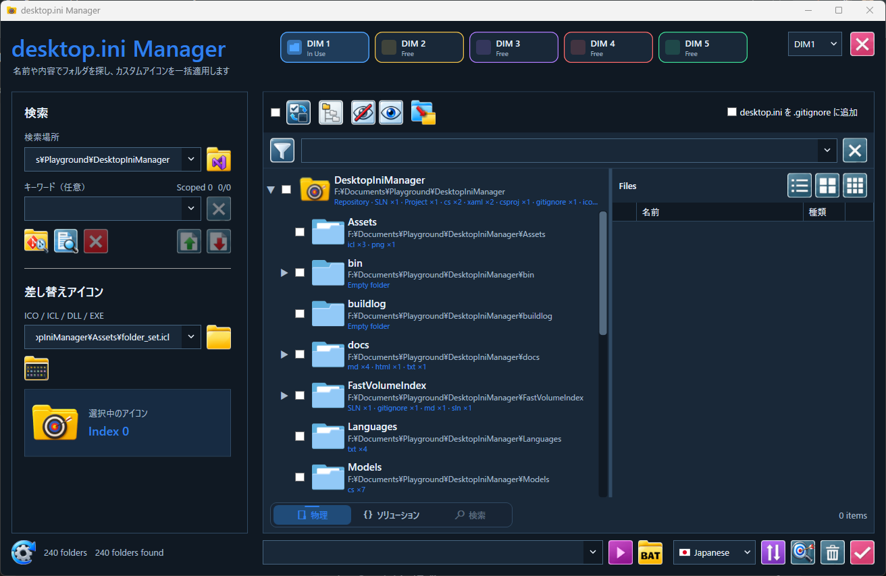
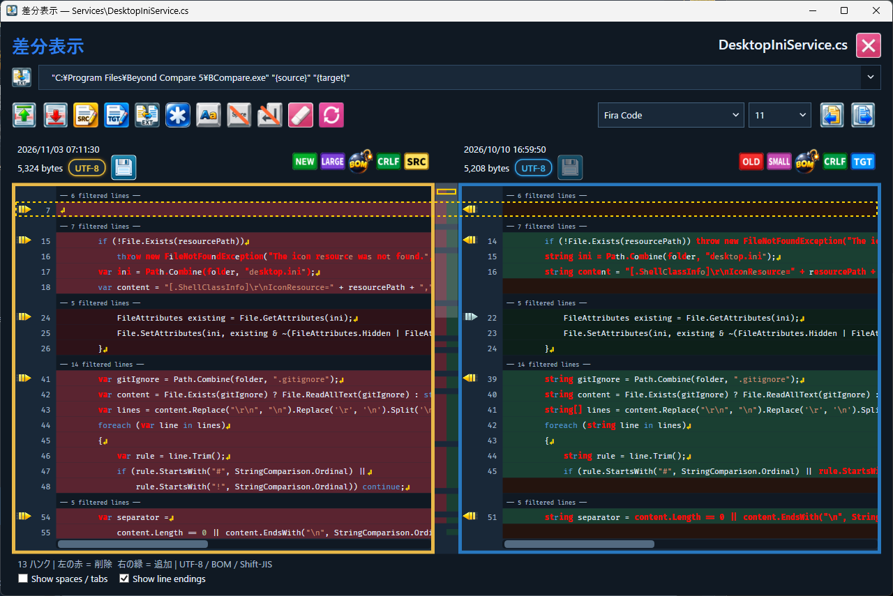
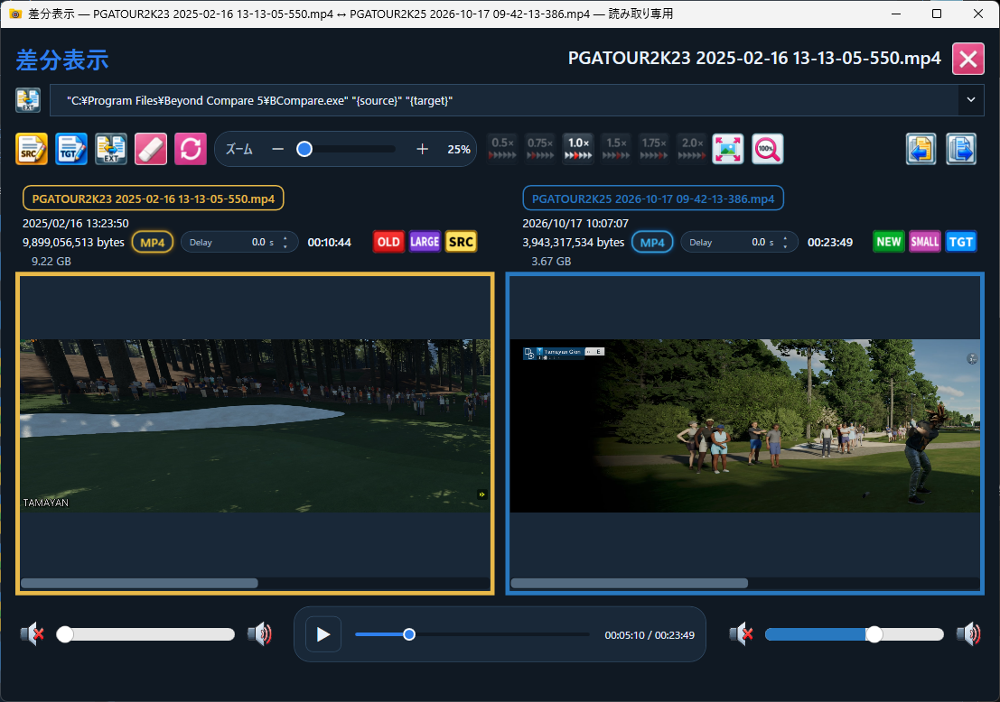
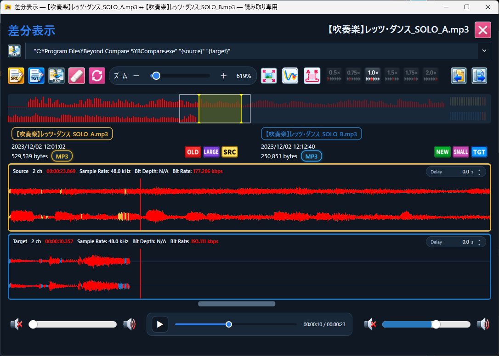

# DesktopIniManager v4.7.6 Release

DesktopIniManager (DIM) is a Windows workspace for exploring development folders and Visual Studio solutions, finding files, running scoped searches, comparing folders, viewing differences, and managing folder icons through `desktop.ini`.

[Website](http://dim.zebrasoft.co.jp/) · [Japanese manual](http://dim.zebrasoft.co.jp/manual.html) · [GitHub downloads](https://github.com/K-Tamashiro/DesktopIniManager/releases) · [Japanese readme](docs/README.txt)



## Download and setup

Download **DesktopIniManager-v4.7.6-win-x64.zip** from the v4.7.6 Release GitHub release assets, not GitHub's source-code archive. The matching `.zip.sha256` contains the SHA-256 checksum.

- Windows 10 or 11, x64; .NET 10 Desktop Runtime (x64) installed separately.
- Visual Studio Build Tools / MSBuild or .NET SDK for solution builds.
- An external editor or diff/merge tool is optional.

Extract into a fresh folder and run **DesktopIniManager.exe**. Keep the DLLs, JSON, Assets and Languages together. ExcelDataReader and PdfPig libraries are required for Document Grep.

## What's new in v4.7.6 Release

**Patch View**

- `.rej` files written by `git am --reject` / `git apply --reject` (the hunks that did not apply) open like `.patch` files. Because rejected hunks no longer match the file exactly, each is placed where most of its pre-change lines match (nearest to its line number on ties); move it with the up/down controls and apply it run by run instead of copying it by eye.

**Text DIFF VIEW**

- Inline differences compare numbers of different lengths from the ones digit: `3739576` → `399006` keeps the matching ones digit `6`. Dotted numbers are compared part by part (`1.2.10` → `1.2.9`). Numbers of the same length are compared as before.
- Syntax highlighting adds Java, Kotlin, Gradle, JavaScript / TypeScript, PHP, CSS / SCSS / Less, HTML, C / C++ (`.c`, `.cpp`, `.h`, …), batch files, PowerShell, shell scripts, `.vbp` / `.vbg` / `.ini`, `.properties`, `Android.mk` / Makefiles, `CMakeLists.txt`, ProGuard (`.pro`) and AIDL.
- Mixed files are highlighted per language: `<script>` as JavaScript and `<style>` as CSS inside HTML and PHP, and `<?php … ?>` as PHP, carrying the state across embedded PHP (for example inside a JavaScript string or an attribute value).
- Android / C++ binaries (`.so`, `.a`, `.o`, `.jar`, `.aar`, `.apk`, `.aab`, `.dex`, `.class`, `.jks`, `.keystore`, `.pch`, …) are treated as binary and skipped when moving to the next / previous file. Files whose first 8 KB contain a NUL byte are also treated as binary, so an unlisted extension no longer stops navigation (UTF-16 / UTF-32 text is excluded).

## Included from v4.7.3 Release

**Text DIFF VIEW**

- Removed the extra **Form header** text button. The VB6 form designer section expands by clicking its fold row.
- Compact **1 filtered lines** rows are now 3 DIP lines instead of 1 DIP, so they are easier to click and expand.
- Syntax highlighting detects the language from the file extension. VB6 / VB.NET (`.bas`, `.frm`, `.cls`, `.ctl`, `.vb`, …), XAML / XML (element names, attribute names such as `x:Name`, attribute values and comments, including tags spanning several lines) and SQL were added; C# and JSON are unchanged.
- A **Syntax Highlight** check box at the bottom right, on the row of **Show spaces / tabs**, turns highlighting on or off (on by default; off shows plain text). The state is restored next time.
- VB6 binary resources and components (`.frx`, `.ctx`, `.dsx`, `.dox`, `.pgx`, `.ocx`, `.oca`, `.tlb`, `.res`) are treated as binary and skipped when moving to the next / previous file.

## Included from v4.7.2 Release

v4.7.2 is the release of the v4.7.0 PreRelease Patch View, with the following additions and refinements.

**Patch View**

- The Target side no longer selects a file. Click the **Target** button (icon 75) to choose the repository folder; its path is shown next to the button. The target file is the repository path plus the patch's file path (`a/` and `b/` prefixes removed, separators converted) and follows the Patch selection. Choosing a subfolder uses the nearest parent folder under which the patch paths exist. The chosen repository is kept for the next start; when opened from Developer Differencer, the comparison Target root is used.
- New files (`--- /dev/null`) whose target does not exist are filled with the whole patch content on the Target side, and the save button is enabled for the patch's file path (missing folders are created). Deleted files (`+++ /dev/null`) show every target line as deleted. Renamed files are looked up by the new path, then by the old path. A missing target keeps the before → after preview.
- The Commit message is read-only text that can be selected and copied.
- The patch side uses the PATCH icon (icon 160) and a dark green image color. The Target header and window title show the actual target file.

**Text and Patch DIFF VIEW**

- A toggle above the scroll map shrinks every **1 filtered lines** row to a 1 DIP line in both panes, bringing the surrounding hunks together. Rows with two or more filtered lines are unchanged; scroll-map markers use the shrunk heights. The state is restored next time.
- The toggle beside the DIFF VIEW title folds the external diff and toolbar rows; this state and the Commit message expansion are restored next time.
- **Esc** clears both inputs and **F5** reloads, like the Clear (icon 140) and Reload (icon 69) buttons.
- In the differences-only view, an expanded VB6 form designer section folds its unchanged rows like the rest of the file; click a fold to expand it.
- Inline differences mark whitespace only when the whitespace itself changed. Numbers are compared as units; numbers of the same length are compared digit by digit at the same position (`17430` → `17745` marks `430` / `745`; `1.2.3` → `1.3.0` marks the changed digits).
- Shift-JIS files containing a few invalid bytes now open. Invalid bytes are shown as U+FFFD, the status bar reports the line, and saving that side is refused instead of corrupting the file.

## Included from v4.7.0 PreRelease

**Patch View: inspect and apply unified / Git patches inside DIFF VIEW.** Open a `.patch` or `.diff` file and DIM lists every changed file. Without a target, DIM previews each file as before → after. With the actual repository file as target, DIM shows the patch's post-change text on the left and the real file on the right, and applies changes hunk by hunk. DIM parses the patch itself and never runs `git apply` or any other patch command.

- Open from the **Open patch / diff** button in Developer Differencer (the comparison Target root becomes the repository root), from the **Patch…** button (icon 159) in DIFF VIEW, or by dropping a patch onto DIFF VIEW.
- `git format-patch` mail headers are decoded; the commit title, author and message appear in a collapsible **Commit message** panel.
- Select the repository folder with the **Target** button (icon 75; changed in v4.7.2, see above). Once the repository root is known, the target file follows the Patch selection.
- Each hunk is located like `git apply`: at the patch line number, adjusted by earlier hunks' drift, otherwise at the nearest matching position. Hunks already contained in the target are recognized, and context mismatches are reported in the status bar.
- A HUNK is one run of changed rows; unchanged context is never inside the frame. The arrow applies exactly that run, and an applied run stays visible with an Undo arrow. Up/down controls move the whole patch hunk by one line when its position needs correction.
- Whitespace and line-ending options follow the text comparison rules. CRLF information carried in the patch is preserved, so CRLF/LF-only differences fold when line endings are ignored.
- Working text and undo history are kept per file while switching files. Saving keeps the target's encoding, BOM and line endings; new-file entries can be saved with a chosen encoding and line ending. Deletion patches save an empty file instead of deleting it. Binary, mode-only and symbolic-link entries are shown as unsupported; paths escaping the repository are rejected. UTF-8 and Shift-JIS patch lines and Git octal-escaped paths are decoded.

**Text DIFF VIEW comparison rules**

- With spaces ignored, leading and trailing whitespace is ignored and each run of spaces/tabs inside a line counts as one space. The presence of a space is still significant: `( - 4)` and `( -4)` differ.
- With line endings ignored, newline-only rows no longer join hunks. They stay as standalone unchanged rows, fold in the differences-only view, and split the surrounding hunks on both sides.
- Copying a single hunk also synchronizes an adjacent newline-only gap; copying the hunks on both sides of a gap together produces one contiguous block without it. Newline-only rows matching on both sides are kept.
- Inline differences mark changed whitespace with a red marker, even when space markers are hidden.
- VB6 `.frm` files fold the form designer section before `Option Explicit` into one expandable row.

**Performance:** faster Code Grep for literal queries, allocation-free `.gitignore` literal rules, cached folder-search display checks, and faster Developer Differencer enumeration and classification.

## Previous release: v4.6.0 Release

**Text DIFF VIEW now supports bidirectional HUNK-level merge operations.** Copy a difference block from Source to Target or from Target to Source using the arrow controls beside each HUNK. After copying, the corresponding control changes to Undo until the changes are saved.

- Copy selected difference blocks in either direction, without requiring an external merge tool.
- Undo copied changes before saving; save modified text files using the save controls.
- Inspect whitespace, line endings, and EOF markers when reviewing text differences.
- Choose the text DIFF font family and size; improved scrolling and visual alignment.
- Text editing and saving are limited to text DIFF VIEW. Image, video, and audio comparison modes remain inspection-only.



## Earlier release: v4.5.7

Added **Explorerメニュー** (Explorer menu) to the main file context menu in both list and icon views. Click it to close DIM's menu and open the classic Windows shell context menu. Available commands include **Open with**, **Create shortcut**, and compatible shell extensions when provided for the selection.

Supports a single file or multiple files in the same folder. The entry is disabled for selections spanning different folders or when no target file is available. This is a click action, not a hover submenu. Menu contents depend on file associations and installed applications and may differ from File Explorer. Selected shell commands can modify files, including shortcut creation, renaming, or deletion when available.

## Earlier release: v4.5.6

- Added independent Source and Target delay controls to Video and Audio DIFF VIEW. Adjust timing in 0.1-second steps, including negative offsets, to compare recordings with different starting points.
- Video DIFF VIEW now provides individual audio volume and mute controls, six playback speeds, and synchronized seeking. Dragging the shared seek slider pauses playback temporarily and resumes from the selected position; each video seek is limited to its own duration.
- Audio DIFF VIEW allows dragging each waveform's playback cursor to adjust that side's delay directly. The delay field and spinner remain synchronized with cursor dragging.
- Video volume controls are disabled and visually dimmed when the corresponding video has no available audio track.


- Adjusted layouts across the DIFF VIEW modes.
- Click the main window title to open the About dialog, which displays the DIM version and information about the libraries and APIs used.

## Main features

- Five independent process slots (DIM1–DIM5), each with its own settings and history.
- Dark, Light and DIM1–DIM5 themes; four UI languages.
- Separate Code Grep and Document Grep profiles; Excel and PDF content search.
- Fixed single-root folder row; folder-name search highlighting; resizable, remembered panes and columns.
- Developer Differencer with independent modification time, size, attributes/BOM and XXH128 checks.
- `.gitignore`-aware comparison, filtering, synchronization and relative-path ZIP export.
- Text DIFF VIEW with HUNK-level copying, Undo and Save; Patch View for unified / Git patches; read-only image/animated GIF, video and WAV/MP3 audio DIFF modes.
- Audio PCM-sample difference highlighting, A–B repeat, independent delay adjustment, synchronized playback and six selectable playback speeds.

## Main window

Click the main window title to view version information and the libraries and APIs used by DIM.


Select a Target root to browse the physical folder tree or Visual Studio Solution structure. Files directly under the selected folder appear first in white; descendants are muted. Folder names participate in search, and checked folders restrict File Search and Scoped Grep to their subtrees. Switch between file-list and two- or three-column icon views.

The tree supports check/uncheck all, inversion, expand/collapse, checked-folder filtering and size adjustment. Use context menus for Explorer, tree/file-list export, builds and Scoped Grep. Choose folder icons from ICO, ICL, DLL or EXE resources, apply/reset them through desktop.ini, and optionally add desktop.ini to .gitignore. Drag folders with immediate files or multiple selected files out of DIM. Batch File Launcher variables: `%d%` directory, `%f%` selected full path, `%n%` file name.

Right-click a file and click **Explorerメニュー** (Explorer menu) to access Windows shell commands. For multi-file operations, select files in the same folder.

## Developer Differencer

Compare yellow Source with blue Target. Paths are indexed on selection; folder-label buttons rescan. Selecting Source can select an existing same-name Target folder; it does not create folders or perform reverse matching.

Enable modification date/time, file size, attributes (including BOM), and XXH128 independently. Enabled metadata and BOM checks are evaluated independently. XXH128 is calculated for files present on both sides only when preceding enabled checks have not already established a difference. With only XXH128 enabled, every file present on both sides is hash-compared. One-sided files and folders are included.

Comparison respects `.gitignore` rules under either selected root, including `*`, `?`, character classes, `**`, anchored paths and `!` negation. An ignored path on either side is excluded from both comparison and synchronization. The ignore dialog can disable individual rules without editing `.gitignore` files; choices are retained in comparison history. Filter Same, Different, Source-only, Target-only, obj, bin and checked entries. Up to 20 dated comparison tabs are retained. Refresh, Solution Clean, ZIP export and synchronization are available; review direction and operations before syncing.

## DIFF VIEW

Layouts have been adjusted across the DIFF VIEW modes in v4.5.6.


Launch as a standalone two-file DIFF VIEW:

```text
DesktopIniManager.exe -diff "C:\work\Source.txt" "C:\work\Target.txt"
```

Each invocation opens an independent process even if all five DIM slots are occupied. `-diff` without paths opens an empty viewer; drop one file onto either side or two files in order. A missing file on one side is supported. The first input selects text, image, video or audio mode. MP3 and WAV can be paired. The clear button (icon 140) resets both sides.

Git difftool configuration:

```ini
[diff]
    tool = dim
[difftool "dim"]
    cmd = DesktopIniManager.exe -diff "$REMOTE" "$LOCAL"
[difftool]
    prompt = false
```

In GitKraken select **Git Config Default**. Text DIFF VIEW supports bidirectional HUNK copying, Undo and Save. The text view provides syntax highlighting (auto-detected from the extension or file name: C#, VB6 / VB.NET, XAML / XML, SQL, JSON, Java, Kotlin, Gradle, JavaScript / TypeScript, PHP, CSS, HTML with embedded script / style / PHP, C / C++, batch, PowerShell, shell, INI / properties, Makefile, CMake and ProGuard; switchable with the Syntax Highlight check box), original line numbers, Source/Target colored frames, a difference map, inline and whitespace differences, line-ending markers and loading progress. The ≠ / ※ controls (or Ctrl+0) toggle differences-only and all-lines views; the last mode is saved.

## Patch View

Open a `.patch` / `.diff` / `.rej` file from Developer Differencer (**Open patch / diff**), with **Patch…** in DIFF VIEW, or by dropping it. The Patch selector lists the changed files; the target file follows it once the repository root is known (the comparison Target root, or the repository folder chosen with the **Target** button, icon 75). Without an actual target the view previews before → after and shows no apply arrows. With a target, the left pane is the patch's post-change text and the right pane is the actual file; apply runs left to right only.

Hunks are located at the nearest matching position like `git apply`. The status bar reports applied hunks, hunks already in the target and context mismatches. Select a HUNK and hover over its frame to show the up/down controls, which move the whole patch hunk by one line. Close or switch files freely: per-file working text and undo are retained, and DIM asks to save, discard or cancel when closing with unsaved changes.

**Manual, hunk-by-hunk patch application.** Unlike `git apply` or `patch`, which apply a whole patch at once or reject it, Patch View lets you review each hunk against the actual file and apply it by hand: apply or undo individual hunks, move a hunk when its context has drifted, recognize hunks already in the target, and save only when the result is right. This makes a patch usable even on a copy whose code has diverged, where an automatic apply would fail.

## Image DIFF VIEW

BMP, JPG/JPEG, PNG, GIF and TIFF/TIF are displayed side by side using nearest-neighbor scaling from 5% to 1600%. A pixel grid appears only at 1600%. ARGB values and coordinates appear at the pointer. Source and Target can independently toggle XOR overlays. Animated GIFs have a frame slider for composed still-frame comparison, respecting frame disposal and transparency.

## Video DIFF VIEW



Source and Target appear side by side with shared playback, seek and zoom controls. Each video has its own **Delay** field (0.1-second steps, positive or negative) and **volume/mute** controls. Playback speeds are selectable from **0.5× to 2.0×**. Dragging the shared seek slider temporarily pauses playback, seeks both sides, then resumes from the selected position. When one video is shorter, its position is limited to its available duration while the other side continues. Volume controls are disabled for videos without an available audio track. Recognized extensions include MP4, AVI, MKV, MOV, WMV, WebM, M4V, MPG and MPEG; playback and audio decoding depend on Windows codecs.

## Audio DIFF VIEW



**Audio-resource difference inspection, before advanced audio analysis.** DIM does more than display two waveform pictures: it compares decoded PCM samples on a common time axis and calculates which intervals differ. Detected differences are highlighted **red** on the yellow Source and blue Target waveforms. This is intended for reviewing voice-guidance files and other audio resources; it is not speech recognition, spectral analysis, or automatic time alignment.

Open WAV (`.wav` / `.wave`) or MP3 files, including mixed WAV/MP3 pairs. Source is above Target. Mono uses one waveform per pane and stereo shows both channels. The common timeline is based on the longer file. Pane headers show duration, channels, sample rate, bit depth and bit rate; mismatching properties appear in red.

- The comparison toggle (icon 143) highlights decoded PCM differences before playback volume adjustment. Channels are compared at corresponding times; missing channels and tails are differences. Different sample rates are resampled to the higher sample rate, without loudness normalization or automatic alignment.
- Differences are detected in 10 ms RMS windows with absolute and relative tolerances; consecutive differing windows are grouped into intervals. No automatic time alignment is performed.
- The top overview shows both complete recordings, playback progress, difference regions and a draggable viewport frame. Click the overview or waveforms to seek; drag the viewport to scroll without changing playback position.
- Drag the Source or Target waveform playback cursor horizontally to adjust that side's delay. The corresponding Delay field and 0.1-second spinner update together; positive values delay that side and negative values advance it.
- A–B repeat allows a selected interval to loop. Source and Target share playback position and speed, while volume and mute are controlled independently.
- Six mutually exclusive playback-speed buttons select **0.5× / 0.75× / 1.0× / 1.5× / 1.75× / 2.0×**. The default is **1.0×**; the selected icon is bright and the others dim. Speed can be changed during playback. Playback speed adjustment may change pitch.
- Horizontal zoom is anchored at the left edge of the current view and expands to the right without changing waveform height. Use the shared scrollbar, Shift+wheel or horizontal wheel; Fit restores the whole timeline. Playback follows the playhead.
- The shorter input contributes silence after it ends. The waveforms themselves are unaffected by playback volume.
- Clipboard paste can load supported text, images, WAVE audio or copied files via private temporary files, removed when the viewer closes.

Audio decoding/playback uses [NAudio 2.2.1](https://github.com/naudio/NAudio), under the [MIT license](docs/licenses/NAudio-LICENSE.txt). No API key or online service is required. DIM provides waveform inspection, calculated difference highlighting and synchronized listening; it does not edit or merge audio.

## Scoped Grep

Use checked folders or separate scope lists with regular expressions, case sensitivity and whole-word matching. Code Grep and Document Grep are separate. Document Grep searches Excel (`.xls`, `.xlsx`, `.xlsm`) and PDF text. Excel hits show sheet/cell; PDF hits show page. Image-only scanned PDFs require external OCR. Results are grouped by file with highlighting, filtering, export, drag-out and up to 20 tabs.

## Slots, themes, languages and encoding

DIM1–DIM5 are independent processes. **In Use** identifies the current slot, **Free** starts another, and **Open** activates an existing process. Settings and history are stored in `%LOCALAPPDATA%\DesktopIniManager\dim-N`. English, Japanese, Simplified Chinese and Korean resources are included. Solution source files are standardized to **UTF-8 with BOM and LF**.

## Distribution and support

Freeware by Tamayan / ZEBRASOFT. [Website](http://dim.zebrasoft.co.jp/) · [Repository and issues](https://github.com/K-Tamashiro/DesktopIniManager) · tamayan@zebrasoft.co.jp.

` scripts/Build-Release.ps1 -PrebuiltDirectory <release-output> ` packages prebuilt v4.7.6 binaries; omitting that option runs `dotnet publish`. Archives and checksums are written to `release/`.

## Keyboard shortcuts and startup options

| Key / option | Action |
| --- | --- |
| Ctrl+1 / 2 / 3 | Main / Developer Differencer / Scoped Grep |
| Ctrl+4 | Open or activate standalone DIFF VIEW |
| Ctrl+Space | Cycle through main views and open DIFF VIEW windows |
| Ctrl+0 | Toggle all lines / differences only |
| Ctrl+Up / Down | Previous / next difference section |
| Ctrl+Left / Right | Previous / next comparison file |
| Shift+wheel / thumb wheel | Horizontal scrolling |
| Page Up / Page Down | Page scroll in text DIFF VIEW |
| Esc | Clear both DIFF VIEW inputs |
| F5 | Reload the DIFF VIEW files |
| `-diff` | Open empty standalone DIFF VIEW |
| `-diff Source Target` | Open standalone DIFF VIEW with specified files |
| `-d1` through `-d5` | Start the selected process slot |
| `%f%`, `%d%`, `%n%` | Batch launcher file path, directory path, file name |
