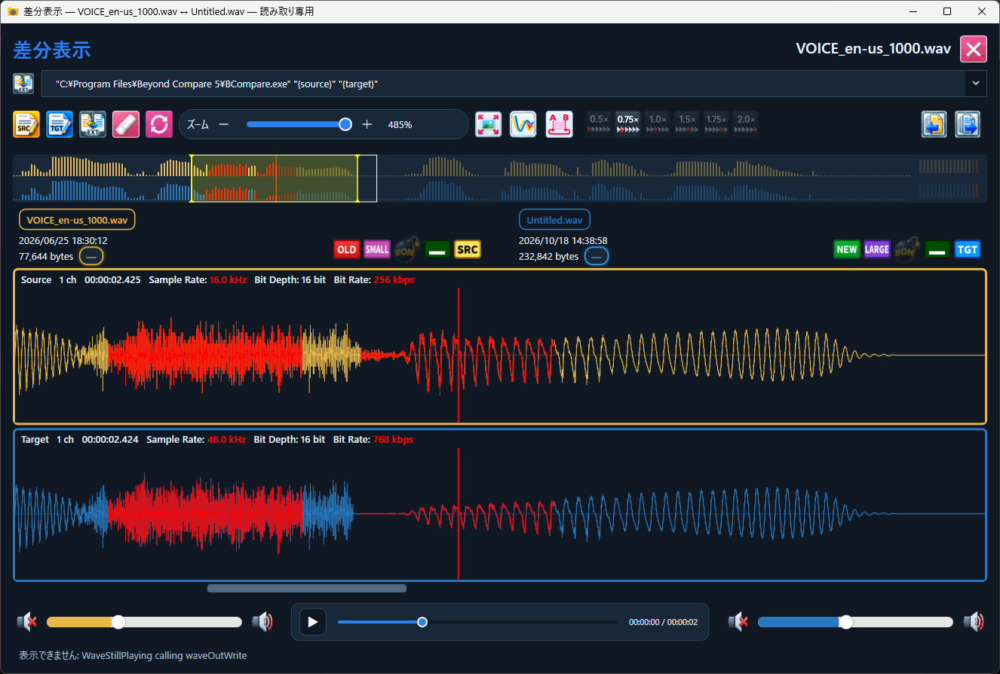

# DesktopIniManager v4.5.0

DesktopIniManager (DIM) is a Windows workspace for exploring development folders and Visual Studio solutions, finding files, running scoped searches, comparing folders, viewing differences, and managing folder icons through `desktop.ini`.

[Website](http://dim.zebrasoft.co.jp/) · [Japanese manual](http://dim.zebrasoft.co.jp/manual.html) · [GitHub downloads](https://github.com/K-Tamashiro/DesktopIniManager/releases) · [Japanese readme](docs/README.txt)


## Download and setup

Download **DesktopIniManager-v4.5.0-win-x64.zip** from the v4.5.0 GitHub release assets, not GitHub's source-code archive. The matching `.zip.sha256` contains the SHA-256 checksum.

- Windows 10 or 11, x64; .NET 10 Desktop Runtime (x64) installed separately.
- Visual Studio Build Tools / MSBuild or .NET SDK for solution builds.
- An external editor or diff/merge tool is optional.

Extract into a fresh folder and run **DesktopIniManager.exe**. Keep the DLLs, JSON, Assets and Languages together. ExcelDataReader and PdfPig libraries are required for Document Grep.

## Main features

- Five independent process slots (DIM1–DIM5), each with its own settings and history.
- Dark, Light and DIM1–DIM5 themes; four UI languages.
- Separate Code Grep and Document Grep profiles; Excel and PDF content search.
- Fixed single-root folder row; folder-name search highlighting; resizable, remembered panes and columns.
- Developer Differencer with independent modification time, size, attributes/BOM and XXH128 checks.
- `.gitignore`-aware comparison, filtering, synchronization and relative-path ZIP export.
- Read-only DIFF VIEW for text, images/animated GIF, video, and WAV/MP3 audio.
- Audio PCM-sample difference highlighting, A–B repeat, synchronized playback and six selectable playback speeds.

## Main window

Select a Target root to browse the physical folder tree or Visual Studio Solution structure. Files directly under the selected folder appear first in white; descendants are muted. Folder names participate in search, and checked folders restrict File Search and Scoped Grep to their subtrees. Switch between file-list and two- or three-column icon views.

The tree supports check/uncheck all, inversion, expand/collapse, checked-folder filtering and size adjustment. Use context menus for Explorer, tree/file-list export, builds and Scoped Grep. Choose folder icons from ICO, ICL, DLL or EXE resources, apply/reset them through desktop.ini, and optionally add desktop.ini to .gitignore. Drag folders with immediate files or multiple selected files out of DIM. Batch File Launcher variables: `%d%` directory, `%f%` selected full path, `%n%` file name.

## Developer Differencer

Compare yellow Source with blue Target. Paths are indexed on selection; folder-label buttons rescan. Selecting Source can select an existing same-name Target folder; it does not create folders or perform reverse matching.

Enable modification date/time, file size, attributes (including BOM), and XXH128 independently. Enabled metadata and BOM checks are evaluated independently. XXH128 is calculated for files present on both sides only when preceding enabled checks have not already established a difference. With only XXH128 enabled, every file present on both sides is hash-compared. One-sided files and folders are included.

Comparison respects `.gitignore` rules under either selected root, including `*`, `?`, character classes, `**`, anchored paths and `!` negation. An ignored path on either side is excluded from both comparison and synchronization. The ignore dialog can disable individual rules without editing `.gitignore` files; choices are retained in comparison history. Filter Same, Different, Source-only, Target-only, obj, bin and checked entries. Up to 20 dated comparison tabs are retained. Refresh, Solution Clean, ZIP export and synchronization are available; review direction and operations before syncing.

## DIFF VIEW

Launch as a standalone read-only two-file viewer:

```text
DesktopIniManager.exe -diff "C:\work\Source.txt" "C:\work\Target.txt"
```

Each invocation opens an independent process even if all five DIM slots are occupied. `-diff` without paths opens an empty viewer; drop one file onto either side or two files in order. A missing file on one side is supported. The first input selects text, image, video or audio mode. MP3 and WAV can be paired. The clear button (icon 140) resets both sides.

Git difftool configuration:

```ini
[diff]
    tool = dim
[difftool "dim"]
    cmd = DesktopIniManager.exe -diff "$REMOTE" "$LOCAL"
[difftool]
    prompt = false
```

In GitKraken select **Git Config Default**. DIM does not edit or merge content. The text view provides syntax highlighting, original line numbers, Source/Target colored frames, a difference map, inline and whitespace differences, line-ending markers and loading progress. The ≠ / ※ controls (or Ctrl+0) toggle differences-only and all-lines views; the last mode is saved.

## Image DIFF VIEW

BMP, JPG/JPEG, PNG, GIF and TIFF/TIF are displayed side by side using nearest-neighbor scaling from 5% to 1600%. A pixel grid appears only at 1600%. ARGB values and coordinates appear at the pointer. Source and Target can independently toggle XOR overlays. Animated GIFs have a frame slider for composed still-frame comparison, respecting frame disposal and transparency.

## Video DIFF VIEW

Source and Target appear side by side with shared playback, seek and zoom controls. Video preview is muted. Recognized extensions include MP4, AVI, MKV, MOV, WMV, WebM, M4V, MPG and MPEG; playback depends on Windows codecs.

## Audio DIFF VIEW



**Audio-resource difference inspection, before advanced audio analysis.** DIM does more than display two waveform pictures: it compares decoded PCM samples on a common time axis and calculates which intervals differ. Detected differences are highlighted **red** on the yellow Source and blue Target waveforms. This is intended for reviewing voice-guidance files and other audio resources; it is not speech recognition, spectral analysis, or automatic time alignment.

Open WAV (`.wav` / `.wave`) or MP3 files, including mixed WAV/MP3 pairs. Source is above Target. Mono uses one waveform per pane and stereo shows both channels. The common timeline is based on the longer file. Pane headers show duration, channels, sample rate, bit depth and bit rate; mismatching properties appear in red.

- The comparison toggle (icon 143) highlights decoded PCM differences before playback volume adjustment. Channels are compared at corresponding times; missing channels and tails are differences. Different sample rates use linear interpolation on the higher-rate time grid, without loudness normalization or automatic alignment.
- A contiguous insertion/deletion can be identified from a matching prefix and shifted suffix when sample rate and channel count match. Only the affected interval is highlighted on the longer side, with a dashed red join marker on the shorter side. Other edits use same-time comparison.
- The top overview shows both complete recordings, playback progress, difference regions and a draggable viewport frame. Click the overview or waveforms to seek; drag the viewport to scroll without changing playback position.
- A–B repeat allows a selected interval to loop. Source and Target share playback position and speed, while volume and mute are controlled independently.
- Six mutually exclusive playback-speed buttons select **0.5× / 0.75× / 1.0× / 1.5× / 1.75× / 2.0×**. The default is **1.0×**; the selected icon is bright and the others dim. Speed can be changed during playback. Playback speed adjustment may change pitch.
- Zoom the horizontal time scale without changing waveform height. Use the shared scrollbar, Shift+wheel or horizontal wheel; Fit restores the whole timeline. Playback follows the playhead.
- The shorter input contributes silence after it ends. The waveforms themselves are unaffected by playback volume.
- Clipboard paste can load supported text, images, WAVE audio or copied files via private temporary files, removed when the viewer closes.

Audio decoding/playback uses [NAudio 2.2.1](https://github.com/naudio/NAudio), under the [MIT license](docs/licenses/NAudio-LICENSE.txt). No API key or online service is required. DIM provides waveform inspection, calculated difference highlighting and synchronized listening; it does not edit or merge audio.

## Scoped Grep

Use checked folders or separate scope lists with regular expressions, case sensitivity and whole-word matching. Code Grep and Document Grep are separate. Document Grep searches Excel (`.xls`, `.xlsx`, `.xlsm`) and PDF text. Excel hits show sheet/cell; PDF hits show page. Image-only scanned PDFs require external OCR. Results are grouped by file with highlighting, filtering, export, drag-out and up to 20 tabs.

## Slots, themes, languages and encoding

DIM1–DIM5 are independent processes. **In Use** identifies the current slot, **Free** starts another, and **Open** activates an existing process. Settings and history are stored in `%LOCALAPPDATA%\DesktopIniManager\dim-N`. English, Japanese, Simplified Chinese and Korean resources are included. Solution source files are standardized to **UTF-8 with BOM and LF**.

## Distribution and support

Freeware by Tamayan / ZEBRASOFT. [Website](http://dim.zebrasoft.co.jp/) · [Repository and issues](https://github.com/K-Tamashiro/DesktopIniManager) · tamayan@zebrasoft.co.jp.

` scripts/Build-Release.ps1 -PrebuiltDirectory <release-output> ` packages prebuilt v4.5.0 binaries; omitting that option runs `dotnet publish`. Archives and checksums are written to `release/`.

## Keyboard shortcuts and startup options

| Key / option | Action |
| --- | --- |
| Ctrl+1 / 2 / 3 | Main / Developer Differencer / Scoped Grep |
| Ctrl+4 | Open or activate standalone DIFF VIEW |
| Ctrl+Space | Cycle through main views and open DIFF VIEW windows |
| Ctrl+0 | Toggle all lines / differences only |
| Ctrl+Up / Down | Previous / next difference section |
| Ctrl+Left / Right | Previous / next comparison file |
| Shift+wheel / thumb wheel | Horizontal scrolling |
| Page Up / Page Down | Page scroll in text DIFF VIEW |
| `-diff` | Open empty standalone DIFF VIEW |
| `-diff Source Target` | Open standalone DIFF VIEW with specified files |
| `-d1` through `-d5` | Start the selected process slot |
| `%f%`, `%d%`, `%n%` | Batch launcher file path, directory path, file name |
